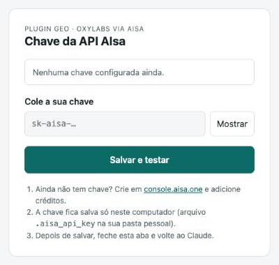

# GEO: o que as IAs respondem sobre uma empresa

Plugin para o **Claude** que mostra o que o **ChatGPT**, o **Gemini** e o **Perplexity** respondem quando um cliente pergunta pelo seu setor. Exemplos: "qual a melhor clínica odontológica de São Paulo?" ou "onde comprar café especial em Curitiba?".

Você informa a empresa e os concorrentes. O plugin faz as perguntas às três IAs como um usuário real faria, e o Claude monta um relatório com:

- em quantas respostas cada marca aparece (share de voz), por IA;
- quem é citado primeiro;
- como as IAs descrevem a empresa;
- perguntas em que os concorrentes aparecem e a empresa não;
- quais sites as IAs usam como fonte (onde vale a pena estar);
- um plano de ação.

As perguntas são feitas pelo **Oxylabs**, que captura a resposta da interface de cada IA, por meio da API da **AIsa**. Você só precisa de uma chave da AIsa.

---

## Sumário

1. [Antes de tudo: a chave da AIsa](#1-antes-de-tudo-a-chave-da-aisa)
2. [Instalar](#2-instalar)
   - [Claude Desktop](#claude-desktop)
   - [Claude Code](#claude-code)
3. [Configurar a chave](#3-configurar-a-chave)
4. [Usar](#4-usar)
5. [Quanto custa](#5-quanto-custa)
6. [Problemas comuns](#6-problemas-comuns)
7. [Instruções de instalação para o Claude](#7-instruções-de-instalação-para-o-claude)
8. [Como funciona por dentro](#8-como-funciona-por-dentro)

---

## 1. Antes de tudo: a chave da AIsa

1. Crie uma conta em [console.aisa.one/sign-up](https://console.aisa.one/sign-up).
2. Adicione créditos. Um relatório completo custa menos de US$ 0,10 (veja [Quanto custa](#5-quanto-custa)).
3. Gere uma chave de API. Ela começa com `sk-aisa-`. Deixe copiada: você vai colar na [tela de configuração](#3-configurar-a-chave).

---

## 2. Instalar

| Você usa | Caminho |
|---|---|
| **App Claude para desktop** (Mac ou Windows) | [Claude Desktop](#claude-desktop) |
| **Claude Code** (aba Code do app ou terminal) | [Claude Code](#claude-code) |

> Não funciona no claude.ai pelo navegador nem no app de celular: o plugin roda no seu computador.

### Claude Desktop

Há duas formas. Escolha uma.

**A. Pela tela de Plugins (colando o endereço do repositório)**

1. No app, abra **Configurações → Personalização → Plugins**.
2. Adicione este repositório pelo endereço:
   ```
   https://github.com/andrealencarz/aisa-geo-oxylabs
   ```
3. Instale **GEO: o que as IAs respondem (Oxylabs via AIsa)** e confira se ele está **ativado**.

Essa forma precisa do **Python 3** no computador. No Mac ele normalmente já existe. No Windows, instale o **Python 3.12** pela **Microsoft Store**. Se não quiser lidar com Python, use a forma B.

**B. Pela extensão (arquivo para baixar, sem Python)**

1. Baixe [**aisa-geo-oxylabs.mcpb**](https://github.com/andrealencarz/aisa-geo-oxylabs/releases/latest/download/aisa-geo-oxylabs.mcpb).
2. Dê dois cliques no arquivo. O Claude Desktop abre a tela de instalação: clique em **Instalar**.
   - Se o arquivo não abrir no Claude: **Configurações → Extensões → Configurações avançadas → Instalar extensão…** e escolha o arquivo.
3. A instalação mostra um campo **Chave da API AIsa**. Pode colar a chave ali ou deixar em branco e usar a [tela de configuração](#3-configurar-a-chave).

Para atualizar a extensão, baixe o arquivo de novo e instale por cima.

### Claude Code

Abra o Claude Code (aba **Code** do app ou `claude` no terminal), cole a mensagem abaixo e envie:

```
Instale este plugin para mim: https://github.com/andrealencarz/aisa-geo-oxylabs
```

O Claude lê as [instruções do repositório](#7-instruções-de-instalação-para-o-claude) e roda **um** comando de instalação. Ele vai pedir permissão uma vez: clique em **Permitir**. Quando terminar, **abra uma sessão nova** para o plugin carregar.

<details>
<summary>Prefere digitar os comandos?</summary>

Dentro do Claude Code:

```
/plugin marketplace add https://github.com/andrealencarz/aisa-geo-oxylabs
```

```
/plugin install aisa-geo-oxylabs@aisa-geo
```

Para atualizar: `/plugin marketplace update aisa-geo` e depois `/plugin update aisa-geo-oxylabs@aisa-geo`.
</details>

---

## 3. Configurar a chave

O plugin tem uma **tela de configuração** própria, que abre no seu navegador:



- **Ela abre sozinha** na primeira vez que você usar o plugin sem chave.
- **Para abrir quando quiser** (cadastrar ou trocar a chave), escreva numa conversa:
  ```
  abra a configuração do plugin GEO
  ```

Cole a chave, clique em **Salvar e testar** e volte ao Claude. A tela testa a chave na AIsa e, se for aceita, guarda no seu computador, num arquivo `.aisa_api_key` na sua pasta pessoal que só o seu usuário lê. Não precisa repetir nas próximas conversas.

> A tela roda só no seu computador (endereço `127.0.0.1`) e o link vale por 15 minutos. Se o navegador não abrir sozinho, o Claude mostra o link para clicar.

Prefere não sair do chat? Também dá para colar direto: `configure minha chave da AIsa: sk-aisa-...`

**Testar:** numa conversa nova, escreva `verifique a configuração do plugin GEO`. A resposta esperada é **"Tudo certo: a chave foi aceita e o Oxylabs LLM está acessível."**

---

## 4. Usar

### Relatório completo

Peça em linguagem natural:

```
faça um relatório GEO da Padaria Bella Massa (bellamassa.com.br) em Belo Horizonte,
concorrentes: Padaria Savassi (padariasavassi.com.br) e Pão & Cia (paoecia.com.br)
```

No Claude Code também existe o atalho `/relatorio-geo`.

O Claude segue o roteiro do plugin:

1. pergunta o que faltar (empresa, site, concorrentes, cidade);
2. sugere de 10 a 20 perguntas que um cliente faria e mostra a lista para você aprovar;
3. calcula quanto vai custar e espera o seu ok;
4. faz as perguntas às três IAs ao mesmo tempo (leva de 1 a 3 minutos);
5. entrega o relatório e salva os dados brutos num arquivo `geo-AAAAMMDD-HHMMSS.json`.

Os dados brutos ficam na pasta da sessão no Claude Code, e em `Documentos/Relatorios GEO` na extensão do Desktop.

### Perguntas avulsas

```
pergunte ao ChatGPT e ao Gemini qual a melhor escola de inglês em Recife e me mostre as fontes que eles usaram
```

---

## 5. Quanto custa

Cada pergunta a uma IA custa cerca de **US$ 0,0015** na AIsa. O preço pode mudar; o plugin sempre cota antes de rodar.

| Relatório | Perguntas × IAs | Custo aproximado |
|---|---|---|
| Rápido | 10 × 3 | US$ 0,05 |
| Completo | 20 × 3 | US$ 0,09 |

Configurar a chave, verificar, cotar e acompanhar jobs é gratuito.

---

## 6. Problemas comuns

| O que aparece | O que fazer |
|---|---|
| "Chave da AIsa não configurada" | Escreva `abra a configuração do plugin GEO` e salve a chave |
| "A AIsa recusou a chave" | A chave foi copiada pela metade ou apagada. Gere outra em [console.aisa.one](https://console.aisa.one) e salve de novo |
| "Chave válida, mas sem saldo" | Adicione créditos em [console.aisa.one](https://console.aisa.one) |
| O Claude não encontra as ferramentas do plugin | Confira se o plugin está **ativado** e abra uma conversa nova. Na forma A do Desktop e no Claude Code, confira também se o Python 3 está instalado; no Desktop, a forma B dispensa Python |
| A tela de configuração não abriu | Use o link que o Claude mostra na resposta. Se ele expirou (15 minutos), peça para abrir de novo |
| Algumas respostas vieram vazias | Uma IA demorou mais que o normal. Rode de novo só as perguntas que faltaram |

Se nada disso resolver, peça ao Claude:

```
o plugin GEO não está funcionando, siga a seção de problemas do https://github.com/andrealencarz/aisa-geo-oxylabs e me ajude
```

---

## 7. Instruções de instalação para o Claude

> Esta seção é para o assistente que vai instalar o plugin a pedido do usuário. O usuário é leigo: explique cada passo em linguagem simples e não repita a chave dele no chat.

**Se você não pode rodar comandos no computador do usuário** (chat do Claude Desktop ou claude.ai): não tente instalar. Passe ao usuário os passos de [Claude Desktop](#claude-desktop) e ajude-o a seguir. A forma B (arquivo `.mcpb`) não precisa de Python.

**Se você pode rodar comandos (Claude Code):** cada comando gera um pedido de permissão, então **rode um único comando**, sem verificações antes:

```bash
claude plugin marketplace add https://github.com/andrealencarz/aisa-geo-oxylabs && python3 ~/.claude/plugins/marketplaces/aisa-geo/instalar.py
```

- Se o usuário já passou a chave da AIsa no chat, acrescente `--chave CHAVE_DO_USUARIO` ao final: o instalador testa a chave sem custo e salva. Sem a chave, a tela de configuração abre no primeiro uso.
- Termina com `✔`: diga que a instalação terminou, que ele precisa **abrir uma sessão nova** e que lá pode escrever `verifique a configuração do plugin GEO`.
- Termina com `✖` ou erro: explique a mensagem e resolva.
  - `python3: command not found` ou Python antigo. No Mac, rode `xcode-select --install` e peça ao usuário para clicar em **Instalar**. No Windows, peça para instalar o **Python 3.12** pela **Microsoft Store**. No Linux, `sudo apt install -y python3`. Depois rode o comando de novo.
  - "A AIsa recusou a chave" ou "sem saldo": o usuário corrige no console da AIsa. Depois, rode de novo com a chave certa ou use a tela de configuração.

---

## 8. Como funciona por dentro

```
Você ──► Claude ──► roteiro do relatório (skill / prompt "Relatório GEO")
                         │
                         ▼
             servidor MCP "aisa-oxylabs" (no seu computador)
                         │  envia a pergunta e espera a resposta
                         ▼
     API AIsa ──► Oxylabs ──► ChatGPT · Gemini · Perplexity
```

| Ferramenta | O que faz | Custo |
|---|---|---|
| `abrir_configuracao` | Abre no navegador a tela para colar e salvar a chave | grátis |
| `configurar_chave_aisa` | Testa e salva a chave colada no chat | grátis |
| `verificar_configuracao` | Confere a chave e o acesso à AIsa | grátis |
| `geo_visibilidade` | Faz um lote de perguntas a várias IAs em paralelo, mede a presença de cada marca e salva o JSON | por pergunta |
| `oxylabs_llm_perguntar` | Faz uma pergunta a uma IA e devolve a resposta e as fontes | por pergunta |
| `oxylabs_llm_cotar` | Cota uma pergunta sem executar | grátis |
| `oxylabs_llm_job` · `oxylabs_llm_listar` · `oxylabs_llm_cancelar` | Acompanham os jobs | grátis |

### Arquivos

```
.claude-plugin/plugin.json        manifesto do plugin (Claude Code e tela de Plugins do Desktop)
.claude-plugin/marketplace.json   permite instalar pelo endereço do GitHub
mcp_server.py                     servidor MCP do plugin (Python, sem dependências)
skills/relatorio-geo/SKILL.md     roteiro do relatório no plugin
instalar.py                       instalador em um comando para o Claude Code
extensao/manifest.json            manifesto da extensão do Desktop (.mcpb)
extensao/server/index.js          servidor MCP da extensão (Node, sem dependências)
extensao/server/relatorio-geo.md  roteiro do relatório na extensão (prompt "Relatório GEO")
extensao/server/config.html       tela de configuração da chave (usada pelos dois servidores)
docs/tela-configuracao.png        imagem da tela de configuração
```

### Para quem mantém o projeto

O plugin (Python) e a extensão (Node) têm a mesma lógica em dois servidores: mudanças precisam ser feitas nos dois.

Gerar o pacote da extensão:

```bash
cd extensao && npx @anthropic-ai/mcpb pack . ../dist/aisa-geo-oxylabs.mcpb
```

Publique o arquivo numa Release do GitHub com o nome `aisa-geo-oxylabs.mcpb`, para o link de download continuar funcionando. Para o plugin, basta subir a versão em `.claude-plugin/plugin.json`.

Testar um servidor sem o Claude:

```bash
printf '%s\n' '{"jsonrpc":"2.0","id":1,"method":"tools/call","params":{"name":"verificar_configuracao","arguments":{}}}' | python3 mcp_server.py
```

---

## Cuidados

- **Respostas de IA mudam a cada vez.** Para acompanhar a evolução, repita as mesmas perguntas todo mês e guarde os arquivos JSON.
- **Visibilidade não é qualidade.** O relatório mostra quem aparece, não quem presta o melhor serviço.
- **Áreas reguladas** (saúde, advocacia, contabilidade): confira as regras de publicidade do conselho profissional antes de publicar conteúdo do tipo "o melhor de…".
- **Os arquivos `geo-*.json` podem ter dados de clientes.** Não publique esses arquivos.

## Licença

MIT. Feito por [André Alencar](http://www.youtube.com/@empreendedorserial).
